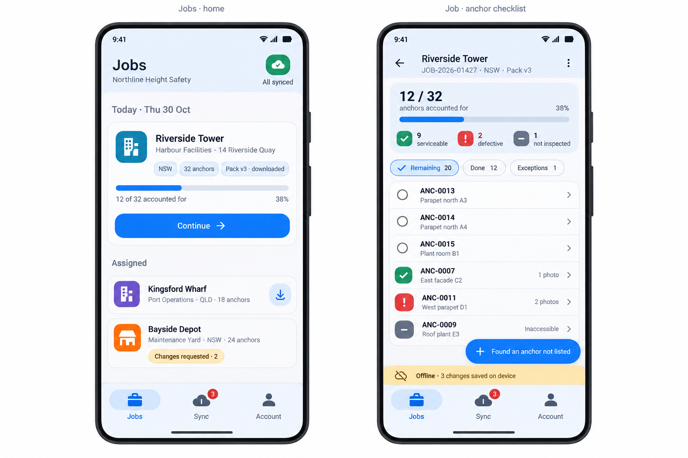
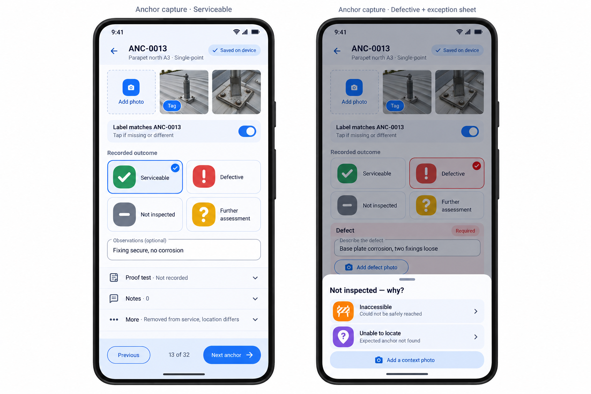
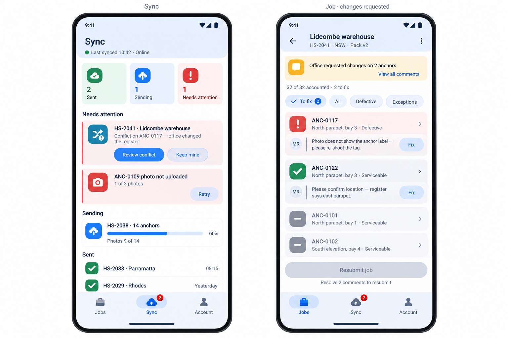
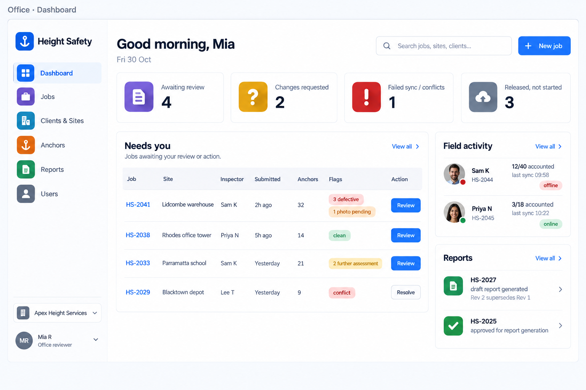
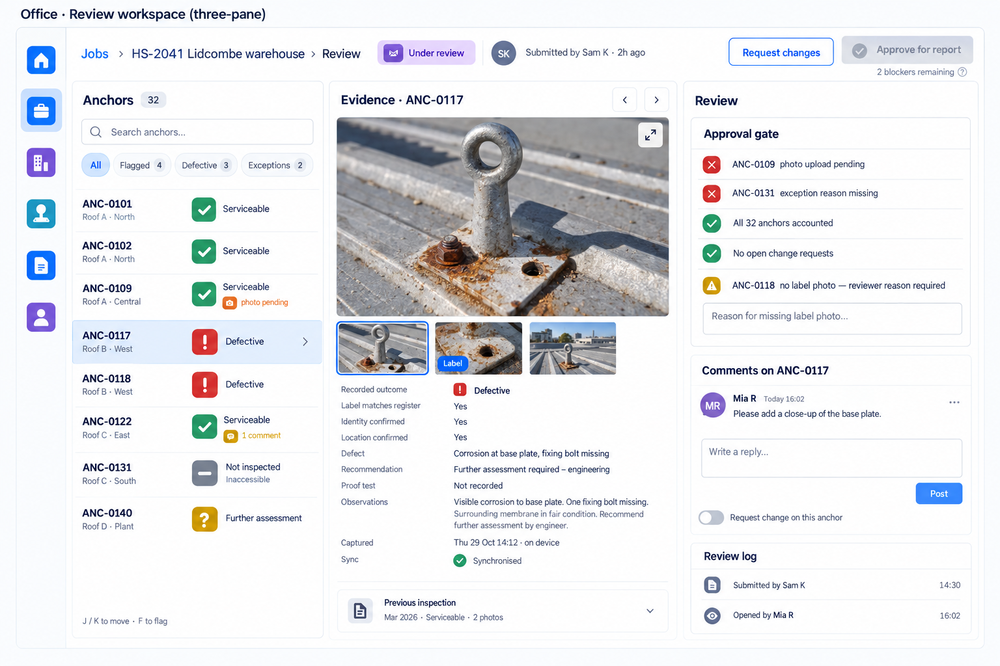
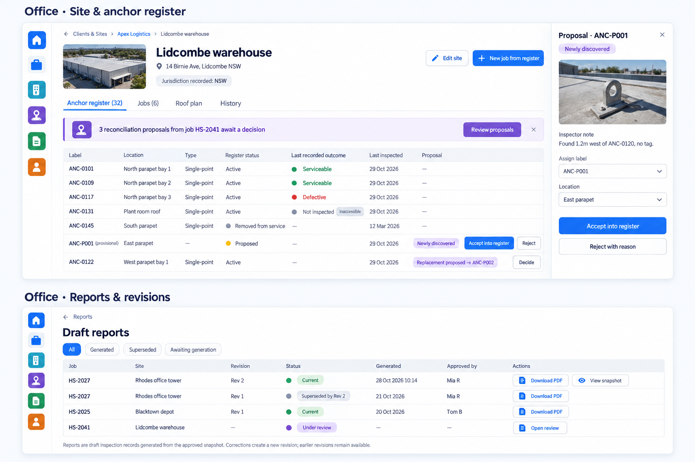
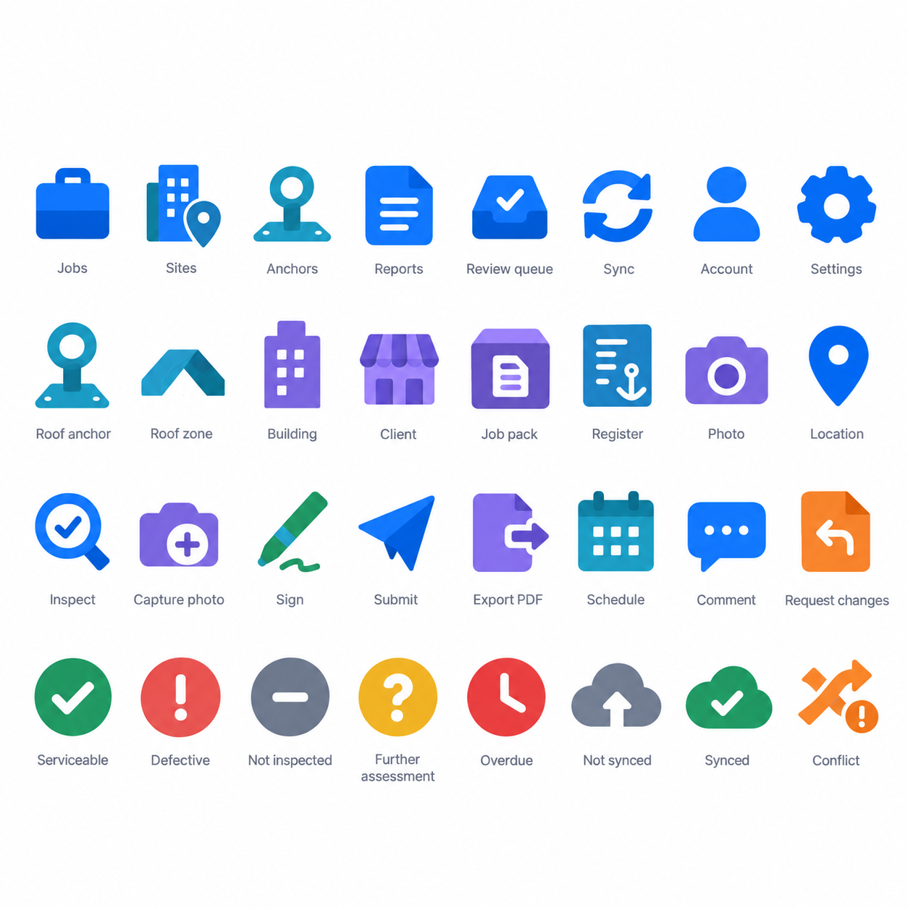
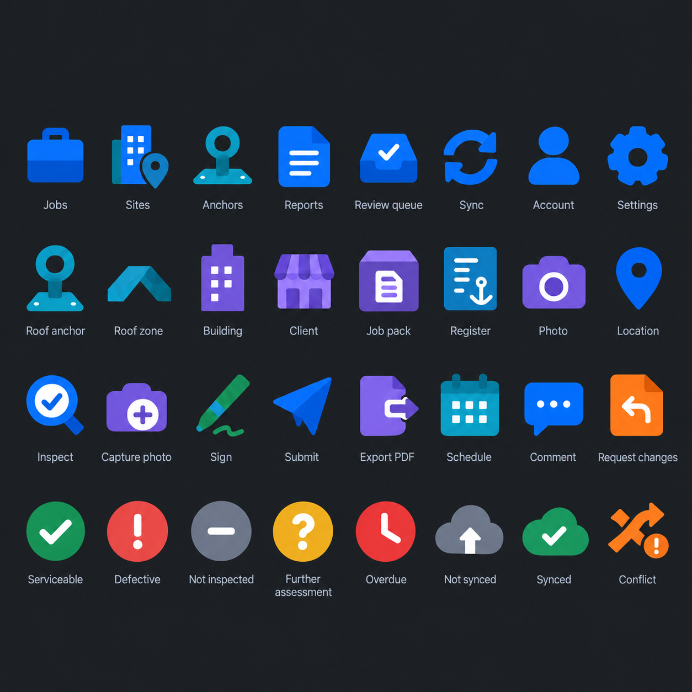
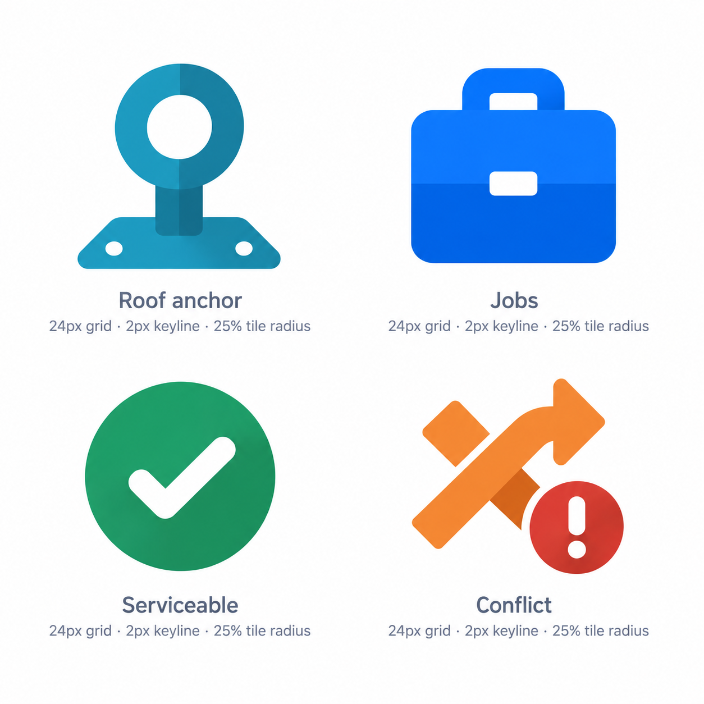

# Height Safety — UX/UI redesign brief

Status: design proposal, not yet implemented. Written against branch `anchor-mvp-reset` at `f1be43d`.
Scope: Android field app + web office app for periodic inspection of installed single-point roof anchors (NSW / QLD).
Out of scope (per `AGENTS.md` and `docs/product/`): other asset families, compliance/certification claims, interval
inference, customer portals, CRM, integrations.

Language rule carried through every screen in this document: the product **records** outcomes and evidence.
It never says "certified", "compliant", "passed inspection" or "approved by engineer". "Approve" on the web
means "approve for report generation" only.

Images referenced below live alongside this file in `design/`. They are mid-fidelity references for layout,
hierarchy and tone, not pixel specs. Android mockups are drawn in Material 3 (Material You) idioms on a Pixel
frame.

---

## 1. Audit of what exists

### 1.1 Web (`apps/web/src/app`)

Three routes exist: `/` (landing), `/office` (jobs table), `/office/reviews/[inspectionId]` (issue list +
request-changes / approve / resolve forms). Findings:

| Problem | Evidence | Impact |
|---|---|---|
| No navigation shell | `layout.tsx` renders children only; no sidebar, header or breadcrumbs | Reviewer cannot move between jobs, sites, anchors, reports without editing the URL |
| No job detail page | `/office/page.tsx` is a flat table; row → review page directly | No way to see a job's anchors, pack version, assignment, or history before review |
| Review page has no evidence | `reviews/[inspectionId]/page.tsx` lists issues as text; no photos, no per-anchor record, no previous inspection | Reviewer approves blind, defeating the purpose of review |
| Disclaimer prose on every page | Each page opens with 2–4 paragraphs of scope/legal wording | Pushes the actual content below the fold; trains users to ignore text |
| Forms are stacked, not contextual | Request-changes and approve forms are both always visible | Unclear which action is available; nothing shows the blocker gate |
| No dashboard / queue | Nothing answers "what needs me today" | Reviewer has to scan the full job table |

### 1.2 Android (`apps/android/app/src/main/kotlin/au/com/heightsafety/app/`)

Single Activity, single Composable, no NavHost, no bottom bar, no `BackHandler`. `FieldScreen.kt` (2198 lines)
switches over 17 `FieldUiState` variants. Linear stack: Sign-in → Jobs → Job pack → {Anchor capture |
Submission review}.

| Problem | Evidence (file:line) | Impact |
|---|---|---|
| System back exits the app from any screen | no `BackHandler`; back is a `TextButton` top-left (`FieldScreen.kt:294-315`) | Mid-capture back gesture loses context |
| Leaving capture silently drops unsaved edits | `FieldViewModel.kt:1152-1162` | Data loss on a roof |
| Reconciliation (4 × 56 dp buttons) sits above the outcome | `FieldScreen.kt:1579-1614` | ~250 dp of rare-case controls before the one decision that matters, every anchor |
| Anchor identity not in the header; header shows the job | `FieldScreen.kt:1513-1517` | Inspector can't tell which anchor they're on while scrolling |
| 7 equal-weight section titles on one scroll, proof test always expanded | `FieldScreen.kt:1567-1771` | Long form, no hierarchy, no progress |
| Validation flicker: red "Still needed" shown before any input, cleared on first tap, back after save | `FieldViewModel.kt:639-652, 1023, 1084` | Feels broken; saving "succeeds" while red list shows |
| Photos: no thumbnails, no delete/retake, no retry; "No photos" styled green | `FieldScreen.kt:1773-1841` | Cannot check what was shot; failed upload has no action |
| "View queued evidence" opens the submission summary, not the evidence | `FieldViewModel.kt:622-625` | After queueing, evidence is unviewable on device |
| Six sync states + three photo states collapsed to "saved locally / queued" prose | `FieldScreen.kt:809-852, 1292-1314` | Conflict and failure are a sentence two screens deep; no action |
| No refresh on loaded job list; no pull-to-refresh | `FieldScreen.kt:691-715` | Only the empty state has "Refresh jobs" |
| Every list item is a card with its own full-width primary button | `FieldScreen.kt:870-935, 1076-1138` | 20 anchors ≈ 4000 dp scroll; every card "shouts" |
| 16 distinct notice paragraphs; "Local evidence remains preserved" ×8; "associated" reassurance ×4 | `strings.xml` 9, 31, 44, 80, 86, 89, 93–95, 111, 119, 122; `CameraCaptureActivity.kt:332` | Architecture documentation leaking into the UI |
| Implementation vocabulary as labels: "Save evidence locally", "Queue submission locally", "Expected register anchor", "Disposition", "Local queue state: Pending" | `strings.xml` 46–52, 69, 107–109; `FieldScreen.kt:2148-2152` | Inspector thinks "Submit", app says "queue" |
| Primary actions at the bottom of long scrolls, not pinned; Sign out is a small top-right text button with no confirm | `FieldScreen.kt:672-679, 1872-1877` | Hard one-handed; destructive action easiest to hit |
| Light theme only, default M3 type, metadata in 12 sp grey | `SignalFieldTheme.kt:15-42, 78-85` | Poor in sunlight |
| Lock glyph reused for device-locked, offline lease, Not inspected, Inaccessible | `FieldScreen.kt:546, 1005, 1933, 1986` | One symbol, four meanings |
| Icons hand-drawn two-tone with hard-coded `Color.White` cut-outs | `SignalFieldIcons.kt:174, 338` | Break on tinted containers / dark theme |
| Missing: anchor history, changes-requested inbox, conflict screen, unsaved-changes dialog, job progress, offline indicator, lease countdown | — | Workflow in `STAGE_2B_WORKFLOW_SPEC.md` has states the app can't show |

Measured cost today for "Serviceable with one photo" on an expected anchor: **9–11 taps, one mandatory free-text
entry, 3–4 long scrolls** per anchor, plus 3 taps + scroll per job to queue.

### 1.3 Existing design candidates (`docs/design/`)

"Signal Field" mobile HTML and the Brilliant office-web export are a reasonable start on colour and card
language, but inherit the same problems: reconciliation before outcome, explanatory copy under every option,
jurisdiction banners on every screen, "Open job pack" buttons on every card. The office-web candidate's sidebar
and list-detail sites are kept and extended here.

---

## 2. Who we are designing for

Evidence class: **V** = validated in `docs/discovery/` or `docs/product/`; **A** = assumption, to confirm with
design partners.

| Persona | Jobs to be done | Conditions | Class |
|---|---|---|---|
| **Inspector** (field) | Account for every expected anchor on the pack; record outcome + photo fast; flag anchors not on the register; know what's sent vs stuck; fix what the office sends back | Roof, gloves, sunlight, one hand, intermittent signal, 24 h offline lease | Roles/lease V; gloves/sunlight A |
| **Office reviewer** | Clear the queue; see evidence per anchor; find flagged anchors first; request precise changes; approve for report when the gate is clean | Desktop, keyboard, many jobs per day | Workflow V; keyboard-heavy A |
| **Administrator** | Set up clients, sites, registers, job packs; assign/release; manage users; decide reconciliation proposals | Desktop | V |

Non-persona: building owners / clients. No portal (non-goal).

---

## 3. What the segment does (research summary)

Patterns adopted and where they come from. Full research notes with citations are in the thread; key sources:

- **Home = today's jobs / assigned list, bottom tabs** — ServiceTitan Field, Jobber, SafetyCulture, Papertrail
  (due / overdue counts as tappable filters). https://help.servicetitan.com/docs/explore-the-main-layout-of-fma,
  https://help.papertrail.io/en/articles/3629548
- **Outcome as icon + label chips, never colour alone**; "Missing" as a first-class state — Papertrail state
  manager, Procore Pass/Fail/N/A with forced photo on fail.
  https://help.papertrail.io/en/articles/8123814,
  https://support.procore.com/procore-mobile-android/user-guide/inspections-android/tutorials/perform-an-inspection-android
- **Conditional fields driven by the answer** (fail → require note/media/action) — SafetyCulture / Mitti logic.
  https://help.mitti.com/000031
- **Per-record sync icon + unsynced badge + "record synced, media pending"** — Fulcrum.
  https://help.fulcrumapp.com/en/articles/462350
- **Explicit list of what's blocked offline; prompt on reconnect** — Limble. https://help.limblecmms.com/en/articles/8857152
- **Flagged-items review panel before completion; approve / reject-to-inspector loop** — SafetyCulture, Fluix.
- **Revisions as first-class objects; superseded status** — Fieldwire submittals.
- **AU practice**: anchors carry a tag with unique ID; layout plan with IDs; photographic evidence incl. tag;
  competent-person identity; defect register. Product records these facts and never infers intervals.
  https://www.worksafe.qld.gov.au/__data/assets/pdf_file/0025/19438/anchors-building-maintenance.pdf,
  https://anchorsafe.com.au/resources/faqs
- **Atlassian icon system**: glyph in a tile, tile radius 25 % of size, sizes 16/20/24/32/40/48, icon-tile
  palette with Bold variants, no shadows/outlines. https://atlassian.design/foundations/logos,
  https://atlassian.design/components/icon/icon-tile/examples, https://atlassian.design/foundations/radius

Nobody in the segment publicly documents glove / sunlight guidance; we fall back to Material 3 (48 dp ≈ 9 mm,
7–10 mm recommended) and WCAG 2.5.5 (44 px enhanced), and go to 56–64 dp for primary field controls.

---

## 4. Information architecture

### 4.1 Android field app

```diagram
┌─────────────────────────────────────────────────────────────┐
│ Bottom nav:  Jobs            Sync (badge)        Account     │
├─────────────────────────────────────────────────────────────┤
│ Jobs ─┬─ Today                                               │
│       └─ Assigned / Available to claim                       │
│            └─ Job (anchor checklist) ─┬─ Anchor capture      │
│                                       ├─ Found anchor (new)  │
│                                       ├─ Comments (changes   │
│                                       │   requested)         │
│                                       └─ Submit sheet        │
│ Sync ─── Needs attention / Sending / Sent                    │
│            └─ Conflict detail (keep mine / take office)      │
│ Account ─ Profile · Company · Offline access until · About   │
│            (disclaimers live here, once) · Sign out          │
└─────────────────────────────────────────────────────────────┘
```

Removed from the field app's main flow: "Job pack" as a separate screen (its context collapses into the job
header), "Submission review" as a page (becomes a bottom sheet with the gate), disclaimers (one About page).

### 4.2 Web office app

```diagram
┌──────────────┬──────────────────────────────────────────────┐
│ Sidebar      │                                              │
│ Dashboard    │  Needs-you queue · counters · field activity │
│ Jobs         │  List → Job detail (anchors, pack versions,  │
│              │  assignment, timeline) → Review workspace    │
│ Clients &    │  Client → Site → tabs: Anchor register ·     │
│  Sites       │  Jobs · Roof plan · History                  │
│ Anchors      │  Cross-site register search; anchor history  │
│ Reports      │  Draft reports with revisions                │
│ Users        │  Roles, assignment                           │
│ ──────────   │                                              │
│ Company ▾    │                                              │
│ User ▾       │                                              │
└──────────────┴──────────────────────────────────────────────┘
```

---

## 5. Key flows

### 5.1 Inspector: record one anchor (target ≤ 4 taps for Serviceable + photo)

1. Job checklist → tap anchor row (opens capture with the next remaining anchor pre-focused).
2. Tap **Add photo** (camera opens; shutter; returns with thumbnail). Optional second shot of the tag.
3. Tap **Serviceable** tile.
4. Tap **Next anchor** (autosaves, advances to next remaining).

Observations are optional for Serviceable; required (with a required photo) for Defective; Further assessment
requires a recommendation. Validation is inline and only after an attempt to advance, never on open.

### 5.2 Inspector: anchor can't be inspected

Tap **Not inspected** → bottom sheet asks why: **Inaccessible** / **Unable to locate**, one tap each, with an
optional context photo. Sheet closes, row shows the slate "Not inspected · Inaccessible" pill. No free text
required.

### 5.3 Inspector: found an anchor not on the register

FAB **Found an anchor not listed** on the checklist → capture screen in "new anchor" mode: photo first, then a
single question "Is this replacing a listed anchor?" (No / Yes → pick from list). Replacement and duplicate
proposals exist but are demoted to this path and the overflow menu on an existing anchor; they never appear on
the standard capture form.

### 5.4 Inspector: submit

Checklist header shows `32/32 accounted`. **Submit job** button (sticky) → sheet lists the gate (uncovered
anchors, missing defect text, pending photos) with tap-to-fix rows, then **Submit**. Sends when online, otherwise
sits in Sync › Sending with "Will send when connected". Status chip on the job card: Sending → Sent → Under
review → Changes requested / Approved.

### 5.5 Inspector: fix changes requested

Job card shows "Changes requested · 2". Opening the job pre-selects the **To fix** filter; each affected row shows
the reviewer comment pinned beneath it with a **Fix** chevron that opens capture at that anchor with the comment
pinned at top. **Resubmit job** enables when all comments are resolved.

### 5.6 Reviewer: clear a job

Dashboard › Needs you › **Review** → three-pane workspace. Left list defaults to **Flagged** filter if any flags
exist. J/K moves, F flags, photos open in a lightbox. Right pane shows the approval gate as a live checklist;
**Approve for report** is enabled only when every hard blocker is green and every warning has a reviewer reason.
**Request changes** gathers all per-anchor change toggles into one message to the inspector.

### 5.7 Admin: decide reconciliation proposals

Site › Anchor register banner "3 proposals await a decision" → slide-over per proposal with the inspector's
photo and note; **Accept into register** (assign label + location) or **Reject with reason**. Replacement
proposals keep the old anchor's history linked.

---

## 6. Screen specifications

### 6.1 Android

The field app is a Material 3 (Material You) app, not a web layout on a phone. Conventions used on every
screen:

- **Navigation bar** (M3 `NavigationBar`) with the active destination shown as a pill indicator; icons are the
  colour-tile set at 24 dp, label always visible; badge on Sync.
- **Top app bars**: Medium for tab roots (Jobs, Sync, Account), Small for pushed screens (job, capture) with
  the back arrow, a two-line title/subtitle and an overflow menu. Collapse on scroll.
- **Tonal surfaces, no shadows**: `surfaceContainerLow` cards, `surfaceContainerHigh` for emphasis (progress
  card, quoted reviewer comments), `tertiaryContainer` for the offline banner and changes-requested banner,
  `errorContainer` tint for needs-attention cards.
- **Dynamic colour**: seed `#1D7AFC`; honour the user's Material You wallpaper palette on Android 12+ for
  neutrals and primary, but outcome and sync colours stay fixed (they carry meaning).
- **Filter chips** (`FilterChip` with leading check when selected) for list scoping; **assist chips** for
  metadata (`NSW`, `32 anchors`, `Pack v3 · downloaded`).
- **Lists** are M3 `ListItem`s (leading tile, headline, supporting text, trailing), 64–72 dp, divided by
  insets not cards. Cards are reserved for the "today" job and progress summaries.
- **Extended FAB** for the single creation action per screen; **bottom app bar** on capture for
  Previous / Next; **modal bottom sheets** with a drag handle for choices (exception reason, label mismatch,
  submit gate); **snackbars** for undo-able actions (photo deleted, outcome changed from overflow).
- **Predictive back** and a `BackHandler` discard guard on capture; edge-to-edge with transparent system bars.
- **Dark theme** from the same tokens; **large-font** scaling tested to 1.3×; touch targets ≥ 56 dp for field
  controls, 72 dp for outcome cards.



**Jobs (home)**
- Header: "Jobs", company name under it, right chip = global sync state (All synced / n unsent / Offline).
- Section **Today**: one card per job planned today. Card = site icon tile, site name, client + address, chips
  `NSW`, `32 anchors`, `Pack v3 · downloaded` / `Not downloaded`, progress bar `12 of 32 accounted`, one
  primary **Continue** (or **Download**, or **Claim**).
- Section **Assigned** / **Available to claim**: compact rows, chevron, no buttons. Status chip replaces
  button when a job is in review: `Changes requested · 2` (yellow), `Under review` (purple), `Approved` (green).
- Pull-to-refresh everywhere; "Refresh" also under overflow.
- States: loading skeletons; empty "No jobs assigned yet — pull to refresh"; offline banner at bottom (yellow,
  cloud-off tile) "Offline · n changes saved on device".

**Job (anchor checklist)**
- App bar: back, site name, `JOB-2026-01427 · NSW · Pack v3` as one subtitle line, overflow (Job details, Roof
  plan if any, Comments, About job).
- Progress card: big `12 / 32 anchors accounted for`, bar, and three counters with outcome tiles
  (serviceable / defective / not inspected / further assessment — show only non-zero).
- Filter chips: **Remaining (20)** default, **Done (12)**, **Exceptions (1)**, **To fix (n)** when present.
- Rows, 64 dp: outcome tile (empty ring when remaining), label `ANC-0013`, location, secondary line `1 photo` or
  `Defective · 2 photos` or `Not inspected · Inaccessible`, chevron. Row tap opens capture. Long-press →
  overflow (Mark not inspected, Propose replacement, Propose duplicate).
- FAB **Found an anchor not listed**.
- Sticky bottom **Submit job** appears when `accounted == expected`; before that the bar shows `n remaining`.



**Anchor capture**
- App bar: back (guards unsaved edits with "Discard changes?" only when there are any), anchor label large, one
  subtitle `Parapet north A3 · Single-point · RoofSafe RS-200`, chip **Saved on device** / **Saving…**.
- Photo strip first: **Add photo** tile (72 dp) + thumbnails with `tag` badge on the one marked as the label
  photo; tap thumbnail → preview with Retake / Delete / Mark as tag photo.
- Switch **Label matches ANC-0013** default on; link **Label missing or different** opens a sheet (Missing /
  Different → enter observed label). This replaces the two "Identity confirmed / Location confirmed" checkboxes
  with one decision that defaults to the common case. Location confirmation moves to a single "Location differs"
  secondary action in overflow.
- **Recorded outcome**: 2 × 2 tile grid, 72 dp tall, icon tile + label: Serviceable (green tick), Defective
  (red exclamation), Not inspected (slate dash), Further assessment (yellow question). Selected tile gets a
  2 dp outline in its colour and a tinted background.
- Conditional: Defective → **Defect** panel (red label "Required for Defective"), text field, "n photos linked"
  chip. Further assessment → **Recommendation** required. Not inspected → exception sheet (see 5.2).
- **Observations** text field (optional for Serviceable).
- Collapsed rows: **Recommendation · optional**, **Proof test performed? · No** (expanding shows Load kN / Hold s
  / Result / Equipment, numeric keyboards), **Notes · 0**. Removed-from-service lives under overflow as a
  disposition action with confirmation.
- Sticky bottom bar: `13 of 32` centred, **Previous** outlined, **Next anchor** filled. Next autosaves and
  advances to the next *remaining* anchor; on the last one it reads **Done** and returns to the checklist.
- Inline validation on Next only: field gets red helper text and the screen scrolls to it.



(Mockup note: the two dimmed "already fine" rows in the changes-requested screen should keep their green
Serviceable tile at reduced opacity; the render shows slate tiles there by mistake.)

**Sync**
- Header: last synced time + Online/Offline dot.
- Summary row: `n sent · n sending · n needs attention`.
- **Needs attention**: conflict card (orange border, teal sync tile) with **Review conflict** / **Keep mine**;
  failed photo card (red border, camera tile) with **Retry upload**. Each card names job + anchor.
- **Sending**: per job, cloud-up tile, progress bar, `Photos 9/14`.
- **Sent**: cloud-tick tile, job, site, time.
- Conflict detail: side-by-side "Yours (on device)" vs "Office (register)" for the fields that differ, actions
  **Keep mine** (sends a change request note to office) / **Take office version**. Local evidence is never deleted
  by either action.

**Account**
- Name, email, company; **Offline access until** with countdown colour (green > 8 h, yellow > 2 h, red); About
  (the single home of scope/legal wording); Sign out with confirmation when unsent changes exist.

**Locked / revoked** keep their current purpose with shorter copy: "Unlock to continue — your saved work is
safe" and one button.

### 6.2 Web



**Dashboard**
- Four counters as filters: Awaiting review (purple), Changes requested (yellow), Failed sync / conflicts (red),
  Released not started (slate).
- **Needs you** table: Job, Site, Inspector, Submitted, Anchors, Flags (pills: `3 defective`, `1 photo pending`,
  `2 further assessment`, `conflict`, `clean`), Action (**Review** / **Resolve**).
- Right rail: **Field activity** (inspector, job, `12/40 accounted`, last sync, online/offline) and **Reports**
  (latest generated / approved).
- Global search (jobs, sites, clients, anchor labels), **New job**.

**Jobs list / Job detail** (not mocked; conventional)
- List: filters by status, inspector, site, date; status pill per row.
- Detail: header with status and workflow stepper (Draft → Released → Assigned → In progress → Submitted → Under
  review → Approved for report → Report generated; "Changes requested" shown as a loop label), tabs: Anchors
  (checklist with outcomes), Pack versions, Assignment, Timeline. Primary action depends on status (Release,
  Assign, Open review, Generate report).



**Review workspace** (three panes)
- Header: breadcrumb, status pill, "Submitted by … · time", **Request changes** (outlined), **Approve for
  report** (filled, disabled until gate is clean; helper "n blockers remaining").
- Pane 1 Anchors: search, chips All / Flagged / Defective / Exceptions, rows with outcome tile + sub-badges
  (`photo pending`, `1 comment`). Keyboard J/K/F. Default filter = Flagged when any.
- Pane 2 Evidence: large photo, thumbnail strip with `Label` badge, fact sheet (Recorded outcome, Label matches
  register, Identity/Location confirmed, Defect, Recommendation, Proof test, Observations, Captured, Sync),
  collapsible **Previous inspection** card.
- Pane 3 Review: **Approval gate** checklist (hard blockers red ✕, satisfied green ✓, warnings amber ⚠ with a
  required reason input), **Comments on ANC-xxxx** thread with "Request change on this anchor" toggle, **Review
  log**.
- Request changes: modal summarises every toggled anchor + comment, sends as one bundle, sets job to Changes
  requested.
- Approve: confirms "This freezes the current snapshot for report generation", then enables **Generate draft
  report**.



**Site › Anchor register**
- Header: site, address, neutral chip `Jurisdiction recorded: NSW` (shown once, here and on the job header, never
  as a banner), **Edit site**, **New job from register**.
- Tabs: Anchor register, Jobs, Roof plan (image upload with pin placement per label, optional), History.
- Proposal banner (purple) → slide-over per proposal with photo, inspector note, Assign label, Location, **Accept
  into register** / **Reject with reason**.
- Table: Label, Location, Type, Register status (Active / Proposed / Removed from service), Last recorded
  outcome (pill), Last inspected, Proposal (pill + action).
- Row click → anchor history drawer: every recorded outcome with photos, by job and date.

**Reports**
- Chips All / Generated / Superseded / Awaiting generation.
- Table: Job, Site, Revision, Status (`Current`, `Superseded by Rev n`, `Under review`), Generated, Approved by,
  Actions (**Download PDF**, **View snapshot**, **Open review**).
- Footnote (the only disclaimer on the page): "Reports are draft inspection records generated from the approved
  snapshot. Corrections create a new revision; earlier revisions remain available."

---

## 7. Behaviour rules

- **Autosave, no "Save" button.** Every field change persists locally within 500 ms; chip shows Saved on device.
- **Advance = validate.** Validation runs only on Next / Submit, inline at the field, and scrolls to the first
  problem.
- **Progressive disclosure by outcome.** Serviceable shows nothing extra. Defective requires defect text + ≥ 1
  photo. Further assessment requires recommendation. Not inspected requires a reason, nothing else.
- **Every expected anchor must be accounted for** before Submit enables; the sheet lists the gaps as tap-to-fix.
- **Sync is visible per job, per anchor, per photo.** Three icons only: cloud-up (sending), cloud-tick (sent),
  alert (needs attention). Never show raw enum names.
- **Conflict never discards.** Both versions are kept; the inspector picks, and the office sees the choice in the
  review log.
- **Offline lease.** Countdown in Account; yellow banner at 2 h; at expiry the app locks capture but keeps
  viewing and Sync available, with copy "Reconnect to extend offline access".
- **Submitted evidence is read-only on device** but always viewable; changes requested re-open only the named
  anchors.
- **Office gate.** Hard blockers: uncovered anchor, missing outcome / exception / defect text, pending or failed
  photo, unresolved conflict, open change request. Warnings need a reviewer reason. Approve freezes the snapshot.
- **One home for legal/scope copy**: Android About, web footer link. No per-screen disclaimers.
- **Jurisdiction** appears as a neutral chip on site and job headers only; it drives nothing.

---

## 8. Visual language

### 8.1 Colour (light; dark derived by swapping surface tokens)

| Token | Light | Use |
|---|---|---|
| brand / primary | `#1D7AFC` (pressed `#0C66E4`) | Primary buttons, selected nav, links |
| teal | `#2898BD` (bold `#227D9B`) | Sites, sync, register |
| purple | `#9F8FEF` (bold `#6E5DC6`) | Jobs, review, proposals, Under review |
| green | `#22A06B` (bold `#1F845A`) | Serviceable, Sent, Current |
| orange | `#F38A3F` (bold `#E56910`) | Anchors (object), conflict |
| red | `#F15B50` (bold `#C9372C`) | Defective, failed, blockers |
| yellow | `#F5CD47` (bold `#CF9F02`) | Further assessment, Changes requested, warnings, offline |
| slate | `#758195` (bold `#44546F`) | Not inspected, removed from service, neutral chips |
| surface / background | `#FFFFFF` / `#F7F8FA` | — |
| text primary / secondary | `#172B4D` / `#44546F` | Secondary text never below 14 sp on Android |

Outcome colours are fixed and never reused for anything else in the same view. Status always = icon tile +
label; colour is reinforcement only.

### 8.2 Type and spacing

Android: Material 3 type scale with `bodyLarge` 16 sp as the minimum for field content and `titleLarge` 22 sp
for anchor labels. Web: Inter or system UI, 14 px body, 13 px table text, 24 px page title. 8 dp grid; 16 dp page
margins on phone; cards radius 12, chips 8, tiles 25 % of size.

### 8.3 Touch

Field controls ≥ 56 dp; outcome tiles 72 dp; photo add tile 72 dp; bottom bar 64 dp. Primary actions pinned at
the bottom; destructive actions behind overflow + confirmation.

---

## 9. Icon system (Atlassian-style colour tiles)







**Construction**
- 24 px grid, 2 px keyline, glyph drawn with rounded outer corners and square line caps.
- Two renderings from one glyph source:
  - **Tile**: solid rounded square, radius 25 % of size, glyph in white. Used for navigation, status, cards,
    counters, empty states. Sizes 20 / 24 / 32 / 40 / 48.
  - **Free glyph**: the glyph filled in the tile colour (two tones allowed: base + bold shade for depth), on
    transparent. Used inline in text, rows and chips at 16 / 20 / 24.
- No shadows, outlines, gradients beyond the two-tone split, or nested containers.
- Dark theme: tile colours unchanged; free glyphs use the lighter shade.
- Android: ship as `ImageVector`s built from paths in a new `HeightSafetyIcons` object, one `tileColor` per
  icon; `contentDescription` set at every call site that is not purely decorative.
- Web: SVG sprite with `currentColor` glyph + CSS variable tile.

**Icon list (name · colour · glyph)**

Navigation and objects
- Jobs · blue · briefcase
- Sites · teal · building with location pin
- Anchors · orange · roof anchor (eye on base plate)
- Reports · green · document with lines
- Review queue · purple · inbox with tick
- Sync · blue · two circular arrows
- Account · blue · person
- Settings · slate · gear
- Roof anchor · teal · anchor eye on plate (object variant)
- Roof zone · teal · roof ridge
- Building · purple · building
- Client · purple · storefront
- Job pack · purple · box with document
- Register · teal · list with anchor
- Photo · purple · camera
- Location · blue · pin
- Schedule · teal · calendar

Actions
- Inspect · blue · magnifier with tick
- Capture photo · purple · camera with plus
- Sign · green · pen
- Submit · blue · paper plane
- Export PDF · purple · document with arrow
- Comment · blue · speech bubble
- Request changes · orange · document with return arrow
- Found anchor (new) · purple · anchor with plus
- Retry · red · circular arrow

Status (fixed meanings)
- Serviceable · green · tick
- Defective · red · exclamation
- Not inspected · slate · dash
- Further assessment · yellow · question mark
- Overdue / lease ending · red · clock
- Not synced · slate · cloud with up arrow
- Sending · blue · cloud with up arrow
- Synced · green · cloud with tick
- Conflict · orange · crossed arrows with red badge
- Offline · yellow · cloud with slash
- Changes requested · yellow · speech bubble with exclamation
- Under review · purple · envelope / open document
- Removed from service · slate · anchor with slash

---

## 10. Platform notes

**Android**
- Add Navigation Compose with three top-level destinations and nested graphs; `BackHandler` on capture for the
  discard guard. Keep the domain module Kotlin/JVM-only (D-026).
- Replace `FieldScreen.kt` with one file per screen; move all user-facing strings to `strings.xml`; delete the
  hard-coded strings in `FieldViewModel.kt` and `CameraCaptureActivity.kt`.
- Camera: keep CameraX; add retake/confirm step and tag-photo flag; show thumbnails from local URIs.
- Sync UI subscribes to the outbox store (Flow) so the Sync tab and job chips update live while WorkManager runs.
- Light + dark `ColorScheme` from the token table; typography override for minimum sizes; test on a 6.1" phone in
  landscape and a 10" tablet (two-pane checklist + capture).

**Web**
- App shell layout with sidebar and breadcrumb in `layout.tsx`; route groups for `/office/(shell)/...`.
- Review workspace keeps all three panes in URL state (`?anchor=ANC-0117&filter=flagged`) so links are shareable.
- Tables virtualised above 200 rows (registers can be large). Keyboard shortcuts documented in a `?` sheet.
- All status pills are one component: `<StatusPill kind="outcome|sync|workflow" value=…>` mapping to the icon
  list above.

---

## 11. Before / after

| Area | Today | Proposed |
|---|---|---|
| Field navigation | Linear stack, text-button back, system back exits app | Bottom tabs Jobs / Sync / Account; proper back stack with discard guard |
| Record Serviceable + photo | 9–11 taps, mandatory text, 3–4 scrolls | 4 taps, no text, no scroll |
| Outcome controls | 4 stacked 56 dp buttons below reconciliation | 2 × 2 tile grid first; reconciliation demoted to FAB / overflow |
| Identity | Two checkboxes | One default-on switch "Label matches ANC-xxxx" |
| Photos | Count + prose, no thumbnails/retry | Photo strip first, tag badge, retake/delete, per-photo retry |
| Save | "Save evidence locally" button at bottom | Autosave; "Saved on device" chip; Next autosaves |
| Validation | Red list on open, flicker | Inline on Next; scroll to field |
| Sync | "Queued locally" prose; six states hidden | Sync tab: Needs attention / Sending / Sent; per-job, per-photo; actions |
| Conflict | One red sentence | Conflict detail with Keep mine / Take office; nothing deleted |
| Changes requested | Not visible on mobile | Job chip, To-fix filter, pinned comments, Resubmit |
| Disclaimers | 16 notices across the flow | One About page; one footnote on Reports |
| Web shell | None | Sidebar, dashboard queue, breadcrumbs, search |
| Review | Issue text list | Three-pane: anchors / evidence with photos / gate + comments |
| Register | Not in UI | Site tabs, proposals slide-over, anchor history drawer |
| Reports | Not in UI | Revisions with Current / Superseded |
| Icons | 24 hand-drawn two-tone glyphs with white cut-outs | ~40 colour-tile icons, one source, tile + free variants |

---

## 12. Decisions made here (veto any)

1. Three bottom tabs, not two or four. Account exists mainly to hold lease countdown and About.
2. Observations optional for Serviceable. The domain currently requires it (`FieldAnchorEvidence.kt:201-205`);
   this is a product change to confirm.
3. "Identity confirmed" + "Location confirmed" collapsed into one default-on "Label matches" switch plus a
   secondary "Location differs" action. Same recorded data, different default.
4. Reconciliation (replacement / duplicate) removed from the standard capture form; reachable via FAB and
   row overflow only.
5. Removed-from-service moved to overflow with confirmation.
6. Submission review page replaced by a gate bottom sheet.
7. Web "Approve" wording: **Approve for report** everywhere; never "Approve inspection".
8. Jurisdiction shown as a chip on site/job headers only.
9. Icon palette follows Atlassian icon-tile hues rather than the repo's current "Blue Horizon" tokens; primary
   shifts from `#1558B0` to `#1D7AFC`.
10. Roof plan tab is optional and image-based (upload + pins), not a drawing tool.

---

## 13. Open questions for design partners

- Do inspectors want Observations on every Serviceable anchor, or only when something is noteworthy?
- Is a tag photo expected on every anchor, or only when the label is missing/different?
- How often do replacement / duplicate proposals happen per job? (Drives whether the FAB path is enough.)
- Does the office want to request changes per anchor (as designed) or per job with free text?
- Proof test: which fields are actually recorded in practice, and in what units?
- Dark theme on the roof: wanted, or is high-contrast light enough?

---

## 14. Build order (thin slice first)

1. **Web shell + dashboard + job detail** — sidebar, counters, needs-you table, job header with status. No new
   data; reads existing jobs/inspections.
2. **Android navigation + jobs home + checklist** — Navigation Compose, bottom tabs, progress card, rows with
   outcome tiles. Capture screen unchanged behind it.
3. **Android capture redesign** — photo strip, outcome tiles, conditional sections, autosave, Next/Previous.
   Domain change for optional observations.
4. **Android Sync tab** — subscribe to outbox; Needs attention / Sending / Sent; photo retry; conflict detail.
5. **Web review workspace** — three panes, gate, comments, request changes bundle.
6. **Changes-requested loop on Android** — job chip, To-fix filter, pinned comments, resubmit.
7. **Site register + proposals + reports revisions** on web.
8. **Icon system** lands incrementally from step 1 (shared source, tile + free variants), replacing
   `SignalFieldIcons.kt` by step 3.

Each step ships runnable; none depends on a later one.
